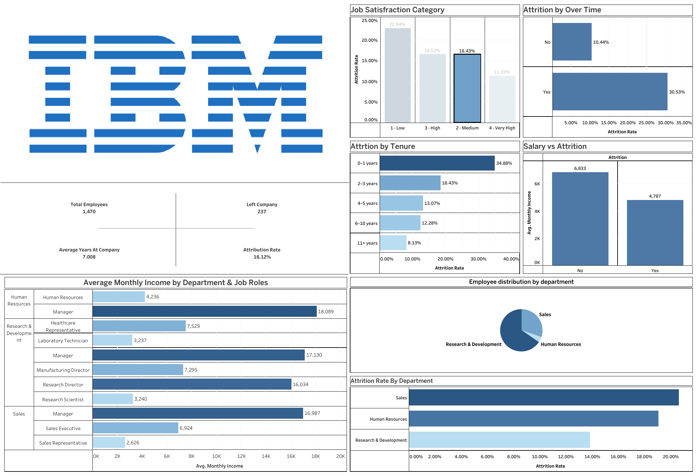

# IBM HR Analytics Dashboard Report

## Overview

The dashboard identifies the factors that lead employee to leave the company using the dataset from [IBM HR dataset on Kaggke](https://www.kaggle.com/datasets/pavansubhasht/ibm-hr-analytics-attrition-dataset).

## Key observations

- Attrition is highest among employees with 0 to 1 year working at the company and generally declines with longer tenure.

- Employees tend to have lower average monthly income than employees who stayed.

- The highest attrition rate is among employees from Sales department, while Research & Development displays the lowest rate. 

- The low job-satisfaction category has the highest attrition rate; the very-high category has the lowest.

## Takeaway

Early-tenure employees and the Sales department stand out as areas to investigate. The dashboard shows associations, not causes; follow-up analysis should account for role, compensation, and other employee characteristics before drawing conclusions.

## Dashboard

